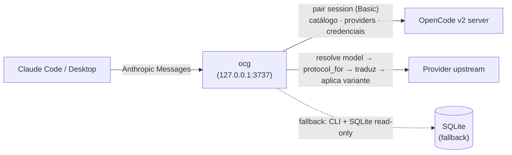

# Arquitetura

[← README](../README.md) · [Configuração](configuracao.md) · [CLI](config-cli.md) ·
[Desktop](config-desktop.md) · [Erros](erros.md) · [Dev](dev.md) ·
**Arquitetura**

`opencode-claude-gateway` é um gateway local compatível com Anthropic que expõe os
modelos do OpenCode v2 ao Claude Code. Escuta apenas em `127.0.0.1` e **nunca**
fala com a Anthropic — o upstream é o backend Go/Console do OpenCode, roteado
pelo pacote (provider).

Há uma única borda de cliente: `POST /v1/messages` (dialecto Anthropic —
Claude Code e Claude Desktop). O gateway fala com o OpenCode v2 pelo fluxo de
pareamento (`POST /api/pair` + `/auth/connect/:code`), obtendo um session
token para ler catálogo, providers e credenciais em `/api/model`,
`/api/provider` e `/api/credential`; o fallback offline é o CLI
(`opencode api get /api/model`) + SQLite somente-leitura.

## Camadas

- **`domain/`** — tipos e regras puras, sem async (`mod.rs` só re-exporta).
  `model.rs` (`ModelRef`: provider/model, sufixo `#variant`), `catalog.rs`
  (`CatalogEntry` deserializa `/api/model` — ou o fallback
  `opencode api get /api/model` — incl.
  `variants`, headers/body por modelo, limites de contexto e linhas de `id`
  distintas), `protocol.rs` (`protocol_for_entry` → protocolo de wire, incl.
  `settings.endpoint` para catálogos mistos `github-copilot`), `alias.rs`
  (`auto_aliases_for` — o id do gateway precisa conter `claude`/`anthropic`
  para a descoberta de `/v1/models` do Claude Code;
  `shield_cli_family_match` reescrita automática do spelling de família nos
  ids anunciados — `claude-sonnet` → `cs`, `claude-opus` → `co`, mais
  `haiku`/`fable`/`mythos` — via `cli_shield_aliases`, default on, para as
  chamadas de fundo do CLI não caírem nessas linhas; reescrita opt-in
  `desktop_aliases` para a denylist do Desktop; `strip_window_suffix` para os
  hints `[1m]`/`[200k]` que o Claude Code anexa a ids desconhecidos).
- **`infra/pair.rs`** — cliente da API v2. Faz `POST /api/pair` pelo CLI
  autenticado, troca o código por um session token em `/auth/connect/:code`
  (`Accept: application/json`) e usa HTTP Basic `opencode:<token>`. Cacheia o
  token em `ocg.pair` (0600), renova em 401 e lê `/api/model`, `/api/provider`
  (provider → `integrationID`) e `/api/credential`. Fallback offline:
  `infra/opencode.rs` (CLI para o catálogo; SQLite read-only para credenciais;
  `auth.json` nunca é fonte de verdade; nunca parseia `opencode.jsonc`).
- **`infra/upstream/`** — tradutores puros (sem HTTP; `upstream.rs` re-exporta
  a superfície pública mais `join_url`):
  - `chat.rs`: `anthropic_to_openai` / `openai_to_anthropic` (Chat Completions)
  - `responses.rs`: `anthropic_to_responses` / `responses_to_anthropic` (Responses API)
  - `stream.rs`: `StreamTranslator` / `ResponsesTranslator` (SSE → Anthropic SSE)
  - `variant.rs`: `apply_variant` — mescla o `reasoning_effort` da variante
    selecionada no body **já traduzido** (os tradutores descartam campos
    desconhecidos). Chave por protocolo: Chat = `reasoning_effort` (labels fora
    do enum da OpenAI saturam para `high`), Responses = `reasoning`, Anthropic
    = no-op.
  - `shared.rs` (interno ao crate): `floor_output_tokens` +
    `cached_input_tokens` (leitura tolerante dos contadores de cache do
    `usage` upstream: `prompt_cache_hit_tokens` do DeepSeek,
    `prompt_tokens_details.cached_tokens`, `input_tokens_details.cached_tokens`)
    + o shaping compartilhado de imagem/tool-result/body dos dois conversores.
  - `estimate.rs`: `estimate_tokens` — contagem local por partes para
    `count_tokens` (sem tokenizer).
  - `heartbeat.rs`: `with_heartbeat` — injeta `event: ping` durante o silêncio
    do upstream; `sse` / `sse_error` — frames Anthropic mid-stream.
- **`api/server.rs`** — handlers Axum. Fluxo do body: resolve model → escolhe o
  forward por `protocol_for` → traduz → aplica variante → forward com o
  `Bearer` da credencial + headers de sessão (`x-opencode-session`, sempre enviado).

## Convenções e pegadinhas

- **Resolução de modelo** (`AppState::resolve`): alias → `provider/model` → id
  simples (ids ambíguos ordenam por nome qualificado, com aviso). Variantes são
  validadas contra o catálogo; label desconhecido → 404 listando as disponíveis.
- **Free-tier**: modelos `opencode/*` dão 403 fora do OpenCode, então ficam
  ocultos de `/v1/models` a menos que `include_free_tier = true`. Desde a v2.3
  a integração `opencode` tem credencial OAuth própria (usada também pelos
  modelos `opencode-go/*`); a chave pública de `settings.apiKey`/`public`
  permanece só como fallback legado.
- **Pacotes suportados**: Anthropic, Chat Completions, Responses API e
  OpenAI-compatible (incl. Mistral, cujo base URL é OpenAI-compatible). O
  pacote `@opencode/ai/providers/google` fala a Generative Language API nativa
  e é **ocultado** do catálogo (não há tradutor), com WARN no boot.
- **Headers de sessão**: o forward para o Go sempre envia `x-opencode-session`
  (o `x-claude-code-session-id` do cliente, depois `x-opencode-session`, senão um
  fallback persistido em `ocg.session`).
- **count_tokens**: pacotes Anthropic fazem proxy para
  `{baseURL}/messages/count_tokens` com fallback em `estimate_tokens`; os outros
  pacotes sempre estimam localmente.
- **Formato de erro**: sempre `{"type":"error","error":{"type":...,"message":...}}`
  com tipos de erro Anthropic (`not_found_error`, `authentication_error`,
  `invalid_request_error`, `api_error`).
- **Cache de prefixo do upstream**: os caminhos traduzidos (Chat/Responses)
  leem os contadores de cache do `usage` upstream (`prompt_cache_hit_tokens`
  do DeepSeek, `prompt_tokens_details.cached_tokens`,
  `input_tokens_details.cached_tokens`) e os expõem como
  `cache_read_input_tokens` no `usage` devolvido ao cliente — só quando > 0,
  para o caso miss manter o shape exato de antes. Cada request de sucesso
  também loga `upstream cache usage` em debug (`gateway_model`/`opencode_ref`/
  `cached_input_tokens`/`input_tokens`). O passthrough Anthropic não muda
  (verbatim, já inclui o que o upstream mandar).
- **Refresh do catálogo** roda em background após o bind; `/health` fica
  `starting` até o primeiro sucesso, `degraded` após falha, `ok` caso contrário.
  Os testes constroem um `AppState` semeado e nunca chamam o binário real.

## Daemon e ciclo de vida

- `ocg --start` escreve pidfile/porta/sessão em
  `~/.local/share/opencode-claude-gateway/` (arquivos `0600` via `daemon::write_private`)
  e spawna o filho com `--daemon-child`.
- `--stop` envia SIGTERM (drena os streams SSE em andamento) e limpa o estado.
- `--status` reporta se o daemon está rodando, em qual porta e o session id.
- `ocg --enable` / `--disable` gerenciam o auto-start no login via systemd
  user service (`autostart.rs`, unit `~/.config/systemd/user/ocg.service`,
  `ExecStart=<bin> --serve`): instala/remove a unit e o symlink `enabled`,
  sem subir nem derrubar o gateway — separação estrita de `--start`/`--stop`.

## Limites conhecidos

- `count_tokens` é estimativa local por partes (sem tokenizer BPE): texto ≈ 1 token/4 chars,
  +overhead por mensagem/tool, imagens base64 pelo tamanho real. Para pacotes Anthropic há proxy
  para `{baseURL}/messages/count_tokens` (com fallback na estimativa se o upstream falhar).
- Modelos free-tier `opencode/*` são bloqueados no upstream fora do OpenCode (ocultos por padrão).
- `ocg.log` é só-append: trunque de vez em quando (`: > ocg.log`).
- `--start` recusa uma `--port` diferente com ele rodando; dê `--stop` antes.

## Documentação relacionada

- [Desenvolvimento](dev.md) — building, testes, comandos.
- [Configuração](configuracao.md) — `config.toml`, aliases e variantes.
- [Erros e diagnóstico](erros.md) — saúde, logs e sintomas.
- [Setup no Claude Code CLI](config-cli.md) — config e uso no dia a dia.
- [Setup no Claude Desktop](config-desktop.md) — o app Desktop.